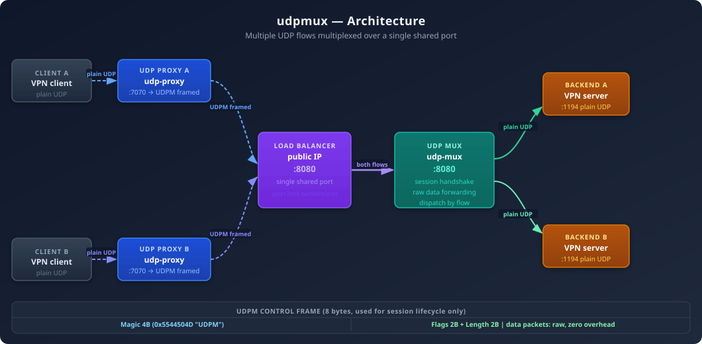
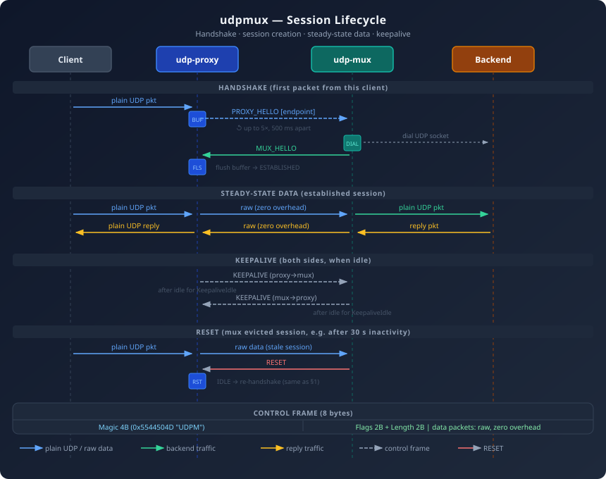

# udpmux
udpmux tunnels multiple UDP flows over a single shared port using a custom binary framing protocol.
The canonical use case is multiplexing several VPN tunnels through one public port.

## Architecture





```
[Client] --plain UDP--> [udp-proxy :7070] --framed UDP--> [udp-mux :8080] --plain UDP--> [backend :1194]
```

### UDP Proxy (`udp-proxy`)
Client-side component. On the first packet from a new client it initiates a session handshake with
the mux (PROXY_HELLO), buffering up to 100 packets while waiting. Once the mux acknowledges
(MUX_HELLO) the session is established and subsequent packets are forwarded raw — no header
overhead. When `--ping` is set the proxy sends periodic PING frames instead of establishing data
sessions, which is useful for checking network connectivity without a backend.

### UDP Mux (`udp-mux`)
Server-side component. Listens on a single UDP port and multiplexes traffic to multiple backends.
It identifies sessions by the client's source address: unknown source triggers a PROXY_HELLO
handshake (which carries the target backend endpoint); known source means the packet is forwarded
raw to the backend. Replies from the backend are sent back to the proxy raw. Also serves an HTTP
API on `:8081` (`GET /metrics`, `GET /healthz`, `GET /readyz`).

## Framing protocol

Control frames use an 8-byte header: `[Magic 4B][Flags 2B][Length 2B]`.
Magic bytes: `0x5544504D` ("UDPM").

Steady-state data is forwarded **raw with zero overhead** — no header on data packets.
Control frames are used only during session lifecycle and connectivity checks:

| Flag          | Direction   | Payload                                    |
|---------------|-------------|--------------------------------------------|
| `PROXY_HELLO` | proxy → mux | backend endpoint string (e.g. `host:port`) |
| `MUX_HELLO`   | mux → proxy | none                                       |
| `RESET`       | mux → proxy | none (triggers re-handshake on the proxy)  |
| `PING`        | proxy → mux | optional padding; mux echoes it back       |

## Session lifecycle

```
IDLE → HANDSHAKING → ESTABLISHED
```

- **IDLE**: first packet triggers PROXY_HELLO retries (up to 5, 500 ms apart); packets are buffered
- **HANDSHAKING**: further packets are buffered
- **ESTABLISHED**: raw data forwarded directly; buffered packets flushed on MUX_HELLO receipt

Sessions expire after inactivity (default: 3 min on the proxy, 5 min on the mux). The proxy
timeout is intentionally shorter so the proxy always expires first — when a client resumes after
a long pause the proxy re-handshakes cleanly rather than sending data on a stale mux session and
losing packets to a RESET.

## CLI reference

### `udp-mux`

```
udp-mux [flags]
```

| Flag | Short | Default | Description |
|---|---|---|---|
| `--listenAddr` | `-l` | `:8080` | UDP address to listen on for proxy traffic |
| `--apiListenAddr` | `-a` | `:8081` | TCP address to listen on for the HTTP API |
| `--sessionTimeout` | | `5m` | Idle duration before a session is garbage-collected |
| `--cleanupInterval` | | `10s` | How often to scan for idle sessions to remove |
| `--maxSessionsPerClient` | | `10` | Max concurrent sessions per client IP; `0` = unlimited |
| `--endpointAllowList` | | _(allow all)_ | Allowed backend endpoint patterns (repeatable); see below |
| `--version` | | | Print version and exit |

#### Session limits (`--maxSessionsPerClient`)

Each unique client IP can have at most this many concurrent sessions. When a new PROXY_HELLO
would exceed the limit the mux sends a RESET and rejects the session. Setting `0` disables the
limit entirely.

#### Endpoint allow list (`--endpointAllowList`)

The allow list controls which backend addresses the mux is permitted to dial. Each entry is a
**Go regular expression** matched against the full `host:port` string from PROXY_HELLO. The flag
is repeatable; a backend is accepted if it matches **any** pattern. When the list is empty (the
default) all backends are allowed.

```sh
# Allow only the OpenVPN port on two specific hosts
udp-mux --endpointAllowList '^10\.0\.0\.1:1194$' \
        --endpointAllowList '^10\.0\.0\.2:1194$'

# Allow any host on port 1194
udp-mux --endpointAllowList ':1194$'
```

When a PROXY_HELLO names an endpoint that does not match any pattern the mux sends a RESET
and logs the rejection. Because entries are regular expressions, special characters (`.`, `*`, etc.)
must be escaped if you intend them as literals.

### `udp-proxy`

```
udp-proxy [flags]
```

| Flag                | Short | Default                      | Description                                                       |
|---------------------|-------|------------------------------|-------------------------------------------------------------------|
| `--listenAddr`      | `-l`  | `:7070`                      | UDP address to listen on for client traffic                       |
| `--muxAddr`         | `-m`  | _(required)_                 | Address of the udp-mux in `host:port` form                        |
| `--endpointAddr`    | `-e`  | _(required unless `--ping`)_ | Backend endpoint the mux should forward to, in `host:port` form   |
| `--ping`            | `-i`  | `false`                      | Send PING frames to the mux instead of establishing data sessions |
| `--pingSize`        | `-s`  | `0`                          | Extra payload bytes to include in each PING frame                 |
| `--sessionTimeout`  |       | `3m`                         | Idle duration before a session is garbage-collected               |
| `--cleanupInterval` |       | `10s`                        | How often to scan for idle sessions to remove                     |
| `--version`         |       |                              | Print version and exit                                            |

#### Ping mode (`--ping`)

When `--ping` is set the proxy does not accept client connections and does not require
`--endpointAddr`. Instead it sends periodic PING frames directly to the mux and logs the
round-trip result. This is useful for verifying that the UDP path between proxy and mux is
open without needing a real backend or client. `--pingSize` adds padding to each PING frame,
which can help detect MTU issues.

## HTTP API (`udp-mux`)

The mux exposes an HTTP API on `--apiListenAddr` (default `:8081`):

| Endpoint       | Description                                                 |
|----------------|-------------------------------------------------------------|
| `GET /metrics` | Prometheus metrics (see below)                              |
| `GET /healthz` | Liveness probe — always `200 OK` when the process is up     |
| `GET /readyz`  | Readiness probe — `200 OK` once the proxy is ready to serve |

### Metrics (`GET /metrics`)

The `/metrics` endpoint exposes Prometheus-compatible metrics in the standard text format.

#### Gauges

| Metric                           | Description                                                                                |
|----------------------------------|--------------------------------------------------------------------------------------------|
| `udpmux_sessions`                | Number of currently active client sessions                                                 |
| `udpmux_clients`                 | Number of distinct client IPs with at least one active session                             |
| `udpmux_avg_sessions_per_client` | Average sessions per client IP, rounded up (`ceil`). Useful for determining session limits |

#### Counters

| Metric                                               | Description                                                                                             |
|------------------------------------------------------|---------------------------------------------------------------------------------------------------------|
| `udpmux_sessions_expired_total`                      | Sessions removed due to inactivity timeout                                                              |
| `udpmux_sessions_reset_total`                        | RESET frames sent to proxies (each RESET increments by 1)                                               |
| `udpmux_bogus_sessions_total`                        | Packets received on an unknown session that were not a valid PROXY_HELLO or PING                        |
| `udpmux_failed_handshakes_total`                     | PROXY_HELLO frames rejected due to a malformed payload or unreachable backend                           |
| `udpmux_clients_blocked_by_session_limit_total`      | PROXY_HELLO frames rejected because the per-client session limit (`--maxSessionsPerClient`) was reached |
| `udpmux_clients_blocked_by_endpoint_allowlist_total` | PROXY_HELLO frames rejected because the requested backend was not in the endpoint allow list            |
| `udpmux_frontend_bytes_read_total`                   | Bytes received from proxies on the frontend UDP socket                                                  |
| `udpmux_frontend_bytes_written_total`                | Bytes sent back to proxies from the frontend UDP socket (backend replies + control frames)              |
| `udpmux_backend_bytes_written_total`                 | Bytes forwarded from proxies to backend endpoints                                                       |
| `udpmux_backend_bytes_read_total`                    | Bytes received from backend endpoints                                                                   |
